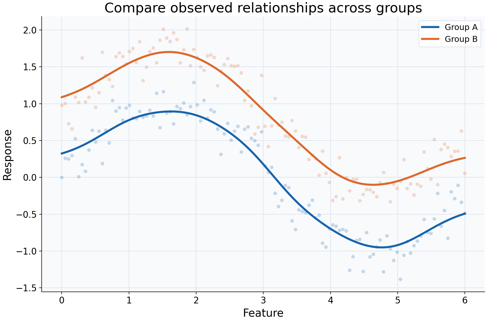
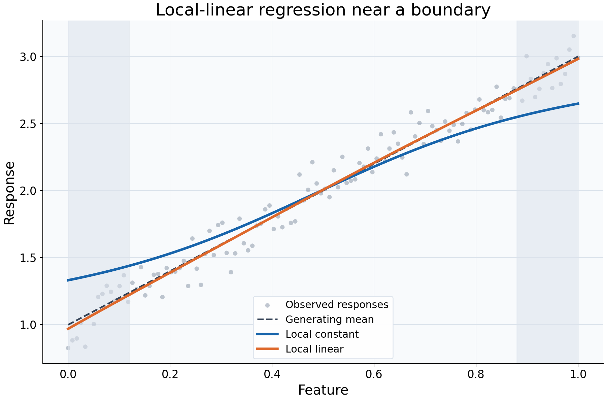

# Examples

Explore one relationship or diagnostic at a time. Each example has its own page
and a large **10 × 6.6 inch figure**, saved at **180 DPI** with readable labels and
legends. Click a plot to inspect the original image at full resolution.

The examples use reproducible synthetic data, so some plots can show the known
generating relationship. Real datasets usually do not supply that ground truth.
See [theory and suitability](theory.md) before interpreting a fitted curve.

## Start with your analysis question

For a complete predictive workflow, start with [demand from temperature](gallery/prediction.md):
train/test splitting, pipeline preprocessing, bandwidth selection, and verified output.

- **A noisy curve needs a summary:** compare [bin counts](gallery/bins.md) or [bandwidths](gallery/bandwidth.md).
- **The mean may hide the response distribution:** compare [response summaries](gallery/summaries.md).
- **Selected groups may behave differently:** fit [subgroup curves](gallery/subgroups.md) and inspect their support.
- **A fitted value needs explaining:** review [observation influence](gallery/influence.md) or [missing support](gallery/support.md).
- **You need to assess the fit:** inspect [residuals](gallery/residuals.md), [boundary behavior](gallery/boundary.md), or [curve intervals](gallery/intervals.md).

Use the same sequence on each page: identify the question, review the choices,
read the plot, run the example, then decide what to change in your own analysis.

## Browse the gallery

<div class="docs-gallery" markdown="1">

<div class="docs-gallery-card" markdown="1">

[](gallery/bins.md)

[Bin count](gallery/bins.md)

</div>

<div class="docs-gallery-card" markdown="1">

[](gallery/bandwidth.md)

[Bandwidth](gallery/bandwidth.md)

</div>

<div class="docs-gallery-card" markdown="1">

[](gallery/subgroups.md)

[Subgroup curves](gallery/subgroups.md)

</div>

<div class="docs-gallery-card" markdown="1">

[](gallery/boundary.md)

[Boundary behavior](gallery/boundary.md)

</div>

<div class="docs-gallery-card" markdown="1">

[](gallery/summaries.md)

[Response summaries](gallery/summaries.md)

</div>

<div class="docs-gallery-card" markdown="1">

[](gallery/influence.md)

[Observation influence](gallery/influence.md)

</div>

<div class="docs-gallery-card" markdown="1">

[](gallery/intervals.md)

[Bootstrap intervals](gallery/intervals.md)

</div>

<div class="docs-gallery-card" markdown="1">

[](gallery/support.md)

[Prediction support](gallery/support.md)

</div>

<div class="docs-gallery-card" markdown="1">

[](gallery/residuals.md)

[Residuals](gallery/residuals.md)

</div>

</div>

## What each example examines

For runnable recipes using your own callbacks, see
[custom aggregations and smoothers](custom_examples.md): native Polars reductions,
NumPy statistics, weighted reducers, descriptive endpoints, and custom kernels.

| Example | Question to review | Main impact or interpretation |
|---|---|---|
| [Bin count](gallery/bins.md) | How much local detail should a response summary retain? | More bins resolve smaller regions but pool fewer observations per estimate. |
| [Bandwidth](gallery/bandwidth.md) | How sensitive is the curve to smoothing scale? | Narrower weighting preserves detail; broader weighting can hide real shape. |
| [Subgroups](gallery/subgroups.md) | Do observed relationships differ within selected groups? | Compare common coordinates and support; differences are descriptive, not adjusted causal effects. |
| [Boundaries](gallery/boundary.md) | What does a local slope change near the feature-range edges? | Compare fitting order at a fixed bandwidth and inspect numerical fallback. |
| [Response summaries](gallery/summaries.md) | Does a mean or median answer the analysis question? | Changing aggregation changes the statistical target; percentile spread differs from uncertainty. |
| [Influence](gallery/influence.md) | Which observations drive one fitted value? | Inspect normalized weights, reweighting, and concentration without confusing them with confidence. |
| [Intervals](gallery/intervals.md) | How variable is the fitted curve under paired resampling? | Pointwise bootstrap bounds depend on sampling assumptions and do not include every source of uncertainty. |
| [Support](gallery/support.md) | Can the selected neighborhood produce an estimate at all? | Missing support and being outside the overall feature range are separate issues. |
| [Residuals](gallery/residuals.md) | What systematic pattern does the fitted curve leave behind? | Residual shape can suggest insufficient fit; training residuals are not held-out accuracy. |

Every page describes the plotted items and their effects, explains how to read the
result, identifies useful applications and limits, and suggests a concrete follow-up.

## Run one plot at a time

```bash
python examples/plot_relationships.py --example bandwidth
```

Each page includes its own command and the relevant plotting function. With no
`--example` argument, the script displays each figure separately; close the
current window to continue to the next one. Install Matplotlib through
`python -m pip install 'rgram[plot]'` first.

To reproduce all documentation figures without a desktop:

```bash
python examples/plot_relationships.py --output-dir docs/_static/gallery
```

Download [the complete gallery script](https://github.com/JackGreenaway/Rgram/blob/main/examples/plot_relationships.py).
Figures are generated from the same functions shown on the example pages.

## Interactive kernel explorer

```bash
uv run python examples/kernel_explorer.py
```

The explorer provides controls for kernel, bandwidth, query location, local
constant/linear fitting, binning, and aggregation. It displays local influence
weights, support counts, effective sample size, and fallback flags. Bootstrap
intervals are calculated only after pressing the interval button. It requires a
desktop backend; GitHub Pages cannot run Python widgets. Download
[the explorer script](https://github.com/JackGreenaway/Rgram/blob/main/examples/kernel_explorer.py) and run it locally.

## Exact neighbor and brute-force paths

```bash
uv run python examples/benchmark_neighbors.py
```

This script supplies already sorted features and a compact tricube kernel, then
times the automatic support-window path against bounded brute-force prediction.
It verifies numerical agreement. Results depend on hardware, sample size,
query count, and bandwidth; they are not a universal speed claim. Download
[the benchmark script](https://github.com/JackGreenaway/Rgram/blob/main/examples/benchmark_neighbors.py).

## Pipelines, selection, and weighted fitting

The [scikit-learn guide](sklearn.md) contains executable examples for fitting,
cloning, preprocessing pipelines, `GridSearchCV`, selecting one feature from a
wider table, and step-prefixed fitting weights. Custom callback examples are in
[the aggregation API](api/aggregation.md), and coverage-aware selection is shown
in [the search reference](api/coverage_search.md).

## Code structure and shared helpers

The gallery keeps data generation, estimation, and interpretation inside nine
small example functions, one per statistical question. Each returns one figure
without saving files or opening windows. `main()` selects the requested examples
and owns display, export, and cleanup. This makes the same functions usable in
headless checks and in an interactive session.

The shared helpers keep presentation consistent rather than concealing analysis:
`_create_axes` makes one large, readable panel; `_plot_observations` displays original
responses; `_add_legend` labels comparisons. The model helper below explicitly
selects a Gaussian kernel and a manual bandwidth measured in feature units:

```python
def _gaussian_smoother(bandwidth: float, **kwargs) -> KernelSmoother:
    """Keep kernel and bandwidth units explicit; kwargs select other model options."""
    return KernelSmoother(
        kernel="gaussian", bandwidth="manual", bandwidth_value=bandwidth, **kwargs
    )
```

Each example fixes a random seed when generating noisy data and holds irrelevant
choices constant during comparisons. Sorted feature construction is explicit;
Rgram itself does not sort observations. Query grids control where a fit is drawn,
not how many observations it learns from. Inline comments identify intentional
outliers, missing support, uncertainty assumptions, and the meaning of diagnostics.
