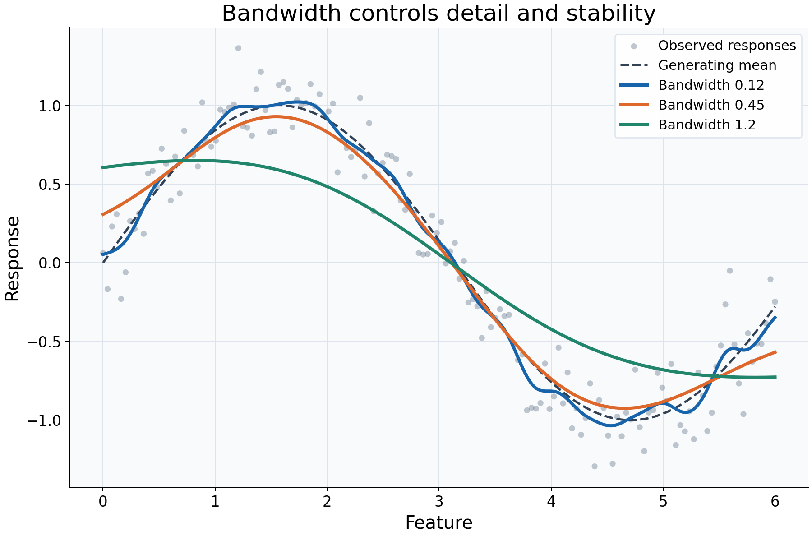

# Choosing a bandwidth

## What this example reviews

Kernel regression pools nearby responses using distance-dependent weights. This
example reviews the neighborhood scale: the same observations, Gaussian kernel,
local-constant fit, and query grid are used throughout, while the manual bandwidth
changes. The comparison isolates smoothing rather than a change in data or model
family.



## Choices and their impact

| Item | What is being reviewed | Impact and interpretation |
|---|---|---|
| Gray observations | Original response variation | Shows the noise that the curves are averaging, rather than eliminating from the data. |
| Dashed generating mean | Known synthetic signal | Helps distinguish recovered structure from extra wiggles or blurred peaks. |
| Bandwidth 0.12 | A narrow distance scale | Concentrates influence locally. The curve follows more detail, which can include sample noise. |
| Bandwidth 0.45 | An intermediate distance scale | Pools more neighboring responses, trading some detail for a steadier curve. It is illustrative, not a recommended universal value. |
| Bandwidth 1.2 | A broad distance scale | Averages across larger parts of the relationship and can flatten peaks, valleys, and transitions. |
| Gaussian kernel and fixed grid | What is deliberately held constant | Bandwidth is a scale in feature units, not a hard radius: the Gaussian has infinite mathematical support. Adding query points changes display resolution only. |

## Interpreting the plot

Compare which broad features survive all three fits, then identify what appears
only at the narrowest scale or disappears at the broadest. More smoothness is not
automatically better, and greater detail is not automatically more faithful. A
small bandwidth may fit random variation; a large bandwidth may average over a
real change in the local mean.

The same numeric bandwidth has a different meaning after changing feature units.
For example, scaling a feature before fitting changes the units in which a manual
bandwidth is interpreted. Compare settings in the coordinate system supplied to
the estimator, and refit after changing them.

## When this is useful

Use this comparison when checking the sensitivity of an exploratory curve,
looking for nonlinear shape, or choosing a readable initial smoothing scale.
Patterns that vary strongly across plausible scales deserve closer inspection
alongside the raw observations and local support.

The plot does not certify which bandwidth predicts new responses best. If
prediction error is the goal, use cross-validation with preprocessing inside the
pipeline, and ensure validation predictions have adequate support.

## Explore further

Change `bandwidth_value`, inspect `predict_diagnostics(query)["effective_n"]`,
and compare the curve with how concentrated its local weights become. Then try a
compact kernel: changing the kernel also changes the meaning of support and can
require retuning bandwidth.

## Run this example

From the checkout, with `rgram[plot]` installed:

```bash
python examples/plot_relationships.py --example bandwidth
# Save just this figure without opening a desktop window:
python examples/plot_relationships.py --example bandwidth --output-dir /tmp/rgram-figures
```

Download [this standalone example](../_static/examples/bandwidth.py).
The complete code below includes imports, data, configuration, and plotting.
Run the downloaded file with `python bandwidth.py`.

```python
from __future__ import annotations

import argparse
from pathlib import Path
from typing import TYPE_CHECKING
import warnings

import numpy as np

from rgram import KernelSmoother, Regressogram, SupportWarning, quantile

if TYPE_CHECKING:
    from matplotlib.axes import Axes
    from matplotlib.figure import Figure

# A consistent palette makes comparisons readable across the gallery.
COLORS = ["#1764ab", "#de682b", "#21856b", "#8855a2"]


def _create_axes(
    title: str, xlabel: str = "Feature", ylabel: str = "Response"
) -> tuple[Figure, Axes]:
    """Create a readable, single-panel figure with consistent gallery styling."""
    import matplotlib.pyplot as plt

    with plt.rc_context({"font.size": 14, "axes.labelsize": 16, "axes.titlesize": 20}):
        figure, ax = plt.subplots(figsize=(10, 6.6), layout="constrained")
        ax.set(title=title, xlabel=xlabel, ylabel=ylabel)
    ax.set_facecolor("#f8fafc")
    ax.grid(color="#dce3ec", linewidth=0.8)
    ax.set_axisbelow(True)
    ax.spines[["top", "right"]].set_visible(False)
    ax.tick_params(labelsize=13)
    return figure, ax


def _plot_observations(ax: Axes, X: np.ndarray, y: np.ndarray) -> None:
    """Show original rows without connecting them or hiding response spread."""
    ax.scatter(
        X,
        y,
        color="#64748b",
        alpha=0.4,
        s=28,
        edgecolors="none",
        label="Observed responses",
    )


def _add_legend(ax: Axes) -> None:
    """Identify every plotted comparison using the same readable legend style."""
    ax.legend(fontsize=12, framealpha=0.96, edgecolor="#dce3ec", loc="best")


def _gaussian_smoother(bandwidth: float, **kwargs) -> KernelSmoother:
    """Keep kernel and bandwidth units explicit; kwargs select other model options."""
    return KernelSmoother(
        kernel="gaussian", bandwidth="manual", bandwidth_value=bandwidth, **kwargs
    )


def bandwidth() -> Figure:
    """Compare three smoothing scales, with the generating curve visible."""
    # Reuse identical observations for each smoothing scale.
    rng = np.random.default_rng(42)
    X = np.linspace(0, 6, 150)
    y = np.sin(X) + rng.normal(0, 0.2, len(X))
    query = np.linspace(0, 6, 350)
    figure, ax = _create_axes("Bandwidth controls detail and stability")
    _plot_observations(ax, X, y)
    ax.plot(query, np.sin(query), "--", color="#334155", lw=2, label="Generating mean")
    # Gaussian bandwidth is a feature scale, not a hard support cutoff.
    # Hold the kernel and query grid fixed to isolate the effect of bandwidth.
    for value, color in zip((0.12, 0.45, 1.2), COLORS):
        model = _gaussian_smoother(value).fit(X, y)
        ax.plot(
            query, model.predict(query), lw=2.8, color=color, label=f"Bandwidth {value}"
        )
    _add_legend(ax)
    return figure

if __name__ == "__main__":
    import matplotlib.pyplot as plt

    figure = bandwidth()
    plt.show()
    plt.close(figure)
```
