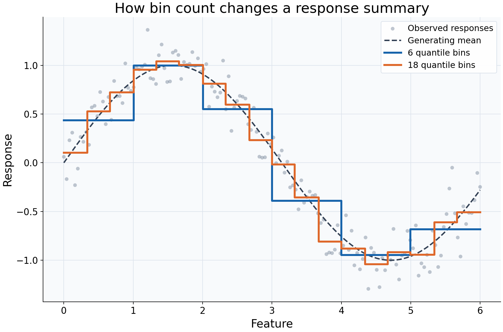

# Choosing a bin count

## What this example reviews

A regressogram turns a feature-response relationship into a table of local
summaries. This example asks how much detail that table should retain. Both fits
receive the same 150 observations and use the same mean aggregation; only the
number of quantile bins changes. The feature coordinates are evenly spaced here,
so quantile cells are approximately equal in width as well as occupancy.



## Choices and their impact

| Item                   | What is being reviewed                   | Impact and interpretation                                                                                                                     |
| ---------------------- | ---------------------------------------- | --------------------------------------------------------------------------------------------------------------------------------------------- |
| Gray observations      | The responses supplied to both fits      | Their scatter shows individual variation that a bin average hides. All rows are retained.                                                     |
| Dashed generating mean | The sine function used in the simulation | Provides a reference for evaluating smoothing here; it would be unknown in ordinary data.                                                     |
| Six-bin curve          | A coarse mean summary                    | Roughly 25 observations contribute per cell in this dataset. Broad patterns are easier to describe, but changes inside a cell are unresolved. |
| Eighteen-bin curve     | A finer mean summary                     | Roughly 8-9 observations contribute per cell here. More local detail appears, with less averaging of response noise.                          |
| Dense query grid       | Evaluation at 350 feature locations      | Makes the display clear; it does not add observations, change boundaries, or improve statistical resolution.                                  |

## Interpreting the plot

Follow the broad rise and fall before focusing on individual steps. If both bin
counts show the same broad pattern, that feature of the summary is less dependent
on this particular resolution choice. A sharper step in the finer curve may be
noise, curvature resolved more finely, or the placement of a boundary. It is not
by itself evidence of a physical threshold.

Each flat segment estimates an average across its cell, not a point-specific
response at every coordinate along the segment. Inspect `bins_` for counts,
observed ranges, and nominal boundaries before interpreting a small cell's value.
With uneven feature density, equal-count cells can have very different widths;
with ties, their counts need not be equal.

## When this is useful

Use this comparison to choose an understandable summary table, inspect broad
nonlinearity, or check whether an apparent feature-response pattern persists
across several bin counts. It is especially useful when counts and ranges must
be reported alongside response summaries.

This in-sample comparison does not identify an optimal predictive bin count or
adjust for other variables. For predictive selection, compare held-out error and
coverage rather than choosing whichever curve looks most detailed.

## Explore further

Try `n_bins=3` and `n_bins=30`, then inspect `bins_["n_samples"]`. Repeat with
`binning="width"` on an unevenly distributed feature to see how a fixed-width
partition differs from a quantile partition. Refit whenever bin settings change.

## Run this example

From the checkout, with `rgram[plot]` installed:

```bash
python examples/plot_relationships.py --example bins
# Save just this figure without opening a desktop window:
python examples/plot_relationships.py --example bins --output-dir /tmp/rgram-figures
```

Download [this standalone example](../_static/examples/bins.py).
The complete code below includes imports, data, configuration, and plotting.
Run the downloaded file with `python bins.py`.

```python
from __future__ import annotations

import argparse
from pathlib import Path
from typing import TYPE_CHECKING
import warnings

import numpy as np

from rgram import KernelSmoother, Regressogram, SupportWarning, quantile

if TYPE_CHECKING:
    from matplotlib.axes import Axes
    from matplotlib.figure import Figure

# A consistent palette makes comparisons readable across the gallery.
COLORS = ["#1764ab", "#de682b", "#21856b", "#8855a2"]


def _create_axes(
    title: str, xlabel: str = "Feature", ylabel: str = "Response"
) -> tuple[Figure, Axes]:
    """Create a readable, single-panel figure with consistent gallery styling."""
    import matplotlib.pyplot as plt

    with plt.rc_context({"font.size": 14, "axes.labelsize": 16, "axes.titlesize": 20}):
        figure, ax = plt.subplots(figsize=(10, 6.6), layout="constrained")
        ax.set(title=title, xlabel=xlabel, ylabel=ylabel)
    ax.set_facecolor("#f8fafc")
    ax.grid(color="#dce3ec", linewidth=0.8)
    ax.set_axisbelow(True)
    ax.spines[["top", "right"]].set_visible(False)
    ax.tick_params(labelsize=13)
    return figure, ax


def _plot_observations(ax: Axes, X: np.ndarray, y: np.ndarray) -> None:
    """Show original rows without connecting them or hiding response spread."""
    ax.scatter(
        X,
        y,
        color="#64748b",
        alpha=0.4,
        s=28,
        edgecolors="none",
        label="Observed responses",
    )


def _add_legend(ax: Axes) -> None:
    """Identify every plotted comparison using the same readable legend style."""
    ax.legend(fontsize=12, framealpha=0.96, edgecolor="#dce3ec", loc="best")


def _gaussian_smoother(bandwidth: float, **kwargs) -> KernelSmoother:
    """Keep kernel and bandwidth units explicit; kwargs select other model options."""
    return KernelSmoother(
        kernel="gaussian", bandwidth="manual", bandwidth_value=bandwidth, **kwargs
    )


def bins() -> Figure:
    """Compare coarse and fine response summaries on identical observations."""
    # Fix the observations so bin count is the only model choice that changes.
    rng = np.random.default_rng(42)
    X = np.linspace(0, 6, 150)
    y = np.sin(X) + rng.normal(0, 0.2, len(X))
    # A dense query grid draws the fitted cells; it adds no training information.
    query = np.linspace(0, 6, 350)
    figure, ax = _create_axes("How bin count changes a response summary")
    _plot_observations(ax, X, y)
    # Ground truth is available only because we generated these observations.
    ax.plot(query, np.sin(query), "--", color="#334155", lw=2, label="Generating mean")
    # More cells preserve finer structure but pool fewer responses per estimate.
    for count, color in zip((6, 18), COLORS):
        model = Regressogram(n_bins=count).fit(X, y)
        ax.step(
            query,
            model.predict(query),
            where="mid",
            lw=2.8,
            color=color,
            label=f"{count} quantile bins",
        )
    _add_legend(ax)
    return figure

if __name__ == "__main__":
    import matplotlib.pyplot as plt

    figure = bins()
    plt.show()
    plt.close(figure)
```
