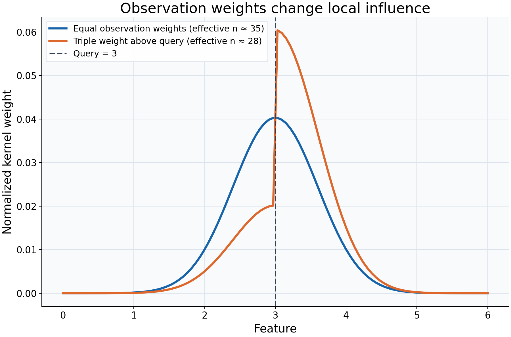

# Inspecting observation influence

## What this example reviews

This example examines which original training observations influence a single
query at feature value 3. Both smoothers use bandwidth 0.6 and the same feature
locations and responses. One gives all rows equal observation weight; the other
gives rows above the query three times as much observation weight.



## Choices and their impact

| Item                      | What is being reviewed                                       | Impact and interpretation                                                                                                          |
| ------------------------- | ------------------------------------------------------------ | ---------------------------------------------------------------------------------------------------------------------------------- |
| Horizontal axis           | Original training feature locations                          | Each plotted value corresponds to a training row, not to a new prediction query.                                                   |
| Vertical axis             | Normalized local kernel/observation weights                  | Describes relative influence at this one query. Each supported curve's weights sum to one.                                         |
| Blue weight curve         | Distance weighting with equal observation weights            | Nearby rows receive more influence, with symmetric geometry in this example.                                                       |
| Orange weight curve       | Distance weighting combined with unequal observation weights | Influence shifts toward the higher-weight side; other normalized weights also change because the total is renormalized.            |
| Dashed line at 3          | The location being predicted                                 | Makes it clear that both weight curves describe the same query.                                                                    |
| Effective n in the legend | Concentration of normalized positive weights                 | Gives an equivalent equal-weight count for concentration, not confidence, sample-size assurance, or regression degrees of freedom. |

## Interpreting the plot

Compare where influence is concentrated and how it shifts after reweighting.
Observation weights multiply the kernel's distance weights before normalization;
they do not move observations or change the fitted bandwidth. Multiplying all
observation weights by the same positive constant would leave these normalized
weights unchanged.

For local-constant fitting, these plotted weights are also the coefficients that
combine responses into a prediction. This equality does not hold for local-linear
fitting: `kind="prediction"` can then return signed coefficients, while
`kind="kernel"` remains nonnegative. The effective-n diagnostic uses the latter.

## When this is useful

Inspect local influence when a fitted value seems surprising, a few observations
appear to dominate, or you need to explain what supplied weights do. The full
matrix follows original training-row order, so weights can be matched to the
stored responses.

Weights express a chosen influence convention. They do not automatically produce
survey-design inference or a causal estimate. A finite estimate dominated by one
row can still have very little local information. `get_weights` allocates a dense
query-by-training matrix; inspect a small query selection rather than an enormous grid.

## Explore further

Move the query or reduce bandwidth, then compare concentration and `effective_n`.
Set selected observation weights to zero and inspect which rows cease contributing.
Try a local-linear fit and compare the two `kind` options explicitly.

## Run this example

From the checkout, with `rgram[plot]` installed:

```bash
python examples/plot_relationships.py --example influence
# Save just this figure without opening a desktop window:
python examples/plot_relationships.py --example influence --output-dir /tmp/rgram-figures
```

Download [this standalone example](../_static/examples/influence.py).
The complete code below includes imports, data, configuration, and plotting.
Run the downloaded file with `python influence.py`.

```python
from __future__ import annotations

import argparse
from pathlib import Path
from typing import TYPE_CHECKING
import warnings

import numpy as np

from rgram import KernelSmoother, Regressogram, SupportWarning, quantile

if TYPE_CHECKING:
    from matplotlib.axes import Axes
    from matplotlib.figure import Figure

# A consistent palette makes comparisons readable across the gallery.
COLORS = ["#1764ab", "#de682b", "#21856b", "#8855a2"]


def _create_axes(
    title: str, xlabel: str = "Feature", ylabel: str = "Response"
) -> tuple[Figure, Axes]:
    """Create a readable, single-panel figure with consistent gallery styling."""
    import matplotlib.pyplot as plt

    with plt.rc_context({"font.size": 14, "axes.labelsize": 16, "axes.titlesize": 20}):
        figure, ax = plt.subplots(figsize=(10, 6.6), layout="constrained")
        ax.set(title=title, xlabel=xlabel, ylabel=ylabel)
    ax.set_facecolor("#f8fafc")
    ax.grid(color="#dce3ec", linewidth=0.8)
    ax.set_axisbelow(True)
    ax.spines[["top", "right"]].set_visible(False)
    ax.tick_params(labelsize=13)
    return figure, ax


def _plot_observations(ax: Axes, X: np.ndarray, y: np.ndarray) -> None:
    """Show original rows without connecting them or hiding response spread."""
    ax.scatter(
        X,
        y,
        color="#64748b",
        alpha=0.4,
        s=28,
        edgecolors="none",
        label="Observed responses",
    )


def _add_legend(ax: Axes) -> None:
    """Identify every plotted comparison using the same readable legend style."""
    ax.legend(fontsize=12, framealpha=0.96, edgecolor="#dce3ec", loc="best")


def _gaussian_smoother(bandwidth: float, **kwargs) -> KernelSmoother:
    """Keep kernel and bandwidth units explicit; kwargs select other model options."""
    return KernelSmoother(
        kernel="gaussian", bandwidth="manual", bandwidth_value=bandwidth, **kwargs
    )


def influence() -> Figure:
    """Inspect which original training rows contribute to a selected query."""
    X = np.linspace(0, 6, 100)
    y = np.sin(X)
    # Inspect a single query: get_weights materializes a query-by-training matrix.
    query = 3.0
    observation_weights = np.ones(len(X))
    # Reweight observations on one side without changing their feature locations.
    observation_weights[X > query] = 3.0
    unweighted = _gaussian_smoother(0.6).fit(X, y)
    weighted = _gaussian_smoother(0.6).fit(X, y, sample_weight=observation_weights)
    figure, ax = _create_axes(
        "Observation weights change local influence", ylabel="Normalized kernel weight"
    )
    for model, label, color in zip(
        (unweighted, weighted),
        ("Equal observation weights", "Triple weight above query"),
        COLORS,
    ):
        # Kernel weights are nonnegative and normalized. With local-constant
        # fitting they also give the coefficients used to combine responses.
        values = model.get_weights([query], kind="kernel")[0]
        # This describes weight concentration, not confidence or degrees of freedom.
        effective_n = model.predict_diagnostics([query])["effective_n"][0]
        ax.plot(
            X,
            values,
            color=color,
            lw=3,
            label=f"{label} (effective n ≈ {effective_n:.0f})",
        )
    ax.axvline(query, color="#334155", linestyle="--", lw=2, label="Query = 3")
    _add_legend(ax)
    return figure

if __name__ == "__main__":
    import matplotlib.pyplot as plt

    figure = influence()
    plt.show()
    plt.close(figure)
```
