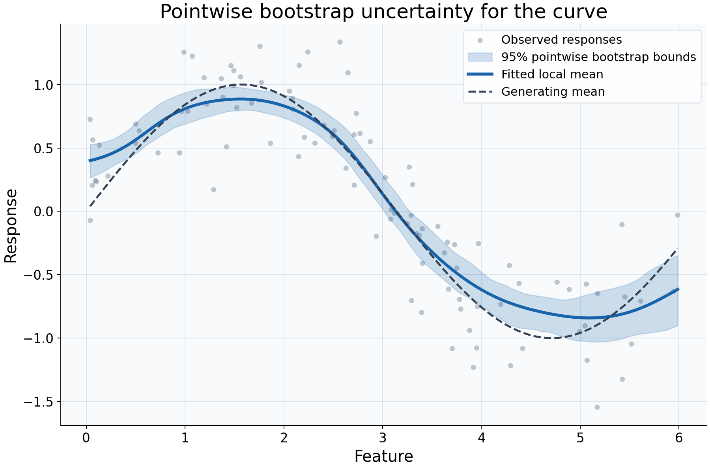

# Pointwise bootstrap intervals

## What this example reviews

This example reviews sampling uncertainty around a fitted regression curve.
Independent synthetic feature values are sampled uniformly, then explicitly
sorted before independent response noise is generated. A Gaussian local-constant
fit uses bandwidth 0.4. Paired IID bootstrap resampling refits the model and
evaluates bounds at 100 locations in the original observed feature range.



## Choices and their impact

| Item                         | What is being reviewed                                   | Impact and interpretation                                                                                                                      |
| ---------------------------- | -------------------------------------------------------- | ---------------------------------------------------------------------------------------------------------------------------------------------- |
| Gray responses               | Variation of individual observations                     | Their vertical spread is response noise, which is not the target of the shaded curve intervals.                                                |
| Blue fitted curve            | The local response mean estimated from the original data | Remains the reference estimate while the bootstrap describes variation across resampled fits.                                                  |
| Shaded 95% bounds            | Pointwise percentile bootstrap intervals                 | At each query, bounds come from the distribution of bootstrap predictions. Connecting them is a display choice, not a simultaneous band.       |
| Dashed generating mean       | Known synthetic relationship                             | Makes possible smoothing bias visible; the bootstrap does not correct that bias.                                                               |
| 100 resamples and fixed seed | Monte Carlo calculation and reproducibility              | The seed makes this run reproducible. More draws improve numerical stability of bootstrap quantiles, not the validity of sampling assumptions. |
| 100 query locations          | Where uncertainty is evaluated                           | More locations increase plotting detail and computation without adding training data.                                                          |

## Interpreting the plot

Read the shaded region as uncertainty about a fitted curve at each separate
location. It is not the expected spread of a future response and does not imply
95% coverage of the entire curve at once. Compare the original fit with the dashed
mean as well as with its bounds: systematic smoothing bias may remain even when
bounds look narrow.

Inspect `n_valid` and `bootstrap_coverage` before interpreting a bound. They count
finite bootstrap predictions, rather than estimating nominal confidence coverage.
The default requires every draw to support a query; otherwise bounds remain NaN.
Resampled feature ranges may differ from the original range, so extrapolation
advisories can occur during this example even though the original queries are in range.

## When this is useful

Use this workflow to explore how sensitive a curve statistic is to sampling and
to communicate its pointwise bootstrap variability. It is more informative than
drawing a response-spread envelope and calling it uncertainty about the mean.

Paired IID resampling assumes independent random-design rows. Grouped or ordered
dependent observations need appropriate resampling choices. The selected bandwidth
is held fixed: these bounds omit bandwidth-selection uncertainty and smoothing-bias
correction. They do not remove confounding or certify extrapolation.

## Explore further

Increase `n_resamples`, retaining the seed and data, to examine Monte Carlo
stability. Change `confidence_level` to compare nominal interval levels. For a
suitable dependent dataset, investigate group/block resampling rather than
interpreting IID bounds as universally valid.

## Run this example

From the checkout, with `rgram[plot]` installed:

```bash
python examples/plot_relationships.py --example intervals
# Save just this figure without opening a desktop window:
python examples/plot_relationships.py --example intervals --output-dir /tmp/rgram-figures
```

Download [this standalone example](../_static/examples/intervals.py).
The complete code below includes imports, data, configuration, and plotting.
Run the downloaded file with `python intervals.py`.

```python
from __future__ import annotations

import argparse
from pathlib import Path
from typing import TYPE_CHECKING
import warnings

import numpy as np

from rgram import KernelSmoother, Regressogram, SupportWarning, quantile

if TYPE_CHECKING:
    from matplotlib.axes import Axes
    from matplotlib.figure import Figure

# A consistent palette makes comparisons readable across the gallery.
COLORS = ["#1764ab", "#de682b", "#21856b", "#8855a2"]


def _create_axes(
    title: str, xlabel: str = "Feature", ylabel: str = "Response"
) -> tuple[Figure, Axes]:
    """Create a readable, single-panel figure with consistent gallery styling."""
    import matplotlib.pyplot as plt

    with plt.rc_context({"font.size": 14, "axes.labelsize": 16, "axes.titlesize": 20}):
        figure, ax = plt.subplots(figsize=(10, 6.6), layout="constrained")
        ax.set(title=title, xlabel=xlabel, ylabel=ylabel)
    ax.set_facecolor("#f8fafc")
    ax.grid(color="#dce3ec", linewidth=0.8)
    ax.set_axisbelow(True)
    ax.spines[["top", "right"]].set_visible(False)
    ax.tick_params(labelsize=13)
    return figure, ax


def _plot_observations(ax: Axes, X: np.ndarray, y: np.ndarray) -> None:
    """Show original rows without connecting them or hiding response spread."""
    ax.scatter(
        X,
        y,
        color="#64748b",
        alpha=0.4,
        s=28,
        edgecolors="none",
        label="Observed responses",
    )


def _add_legend(ax: Axes) -> None:
    """Identify every plotted comparison using the same readable legend style."""
    ax.legend(fontsize=12, framealpha=0.96, edgecolor="#dce3ec", loc="best")


def _gaussian_smoother(bandwidth: float, **kwargs) -> KernelSmoother:
    """Keep kernel and bandwidth units explicit; kwargs select other model options."""
    return KernelSmoother(
        kernel="gaussian", bandwidth="manual", bandwidth_value=bandwidth, **kwargs
    )


def intervals() -> Figure:
    """Display supported pointwise bootstrap bounds for a regression curve."""
    rng = np.random.default_rng(17)
    # Sample a random design with independent noise, appropriate to paired IID draws.
    # Sorting is explicit here for the display; the estimator never sorts rows.
    X = np.sort(rng.uniform(0, 6, 100))
    y = np.sin(X) + rng.normal(0, 0.3, len(X))
    # Keep original queries in the observed range; resampled ranges can differ.
    query = np.linspace(X.min(), X.max(), 100)
    model = _gaussian_smoother(0.4).fit(X, y)
    # Fix the seed for reproducibility. More draws reduce Monte Carlo variation,
    # but do not correct smoothing bias or include bandwidth-selection uncertainty.
    interval = model.predict_interval(query, n_resamples=100, random_state=17)
    figure, ax = _create_axes("Pointwise bootstrap uncertainty for the curve")
    _plot_observations(ax, X, y)
    # Connecting pointwise bounds is a display choice, not a simultaneous band.
    # NaN bounds would remain gaps rather than being silently filled.
    ax.fill_between(
        query,
        interval["lower"].to_numpy(),
        interval["upper"].to_numpy(),
        color=COLORS[0],
        alpha=0.2,
        label="95% pointwise bootstrap bounds",
    )
    ax.plot(
        query,
        interval["prediction"].to_numpy(),
        color=COLORS[0],
        lw=3,
        label="Fitted local mean",
    )
    ax.plot(query, np.sin(query), "--", color="#334155", lw=2, label="Generating mean")
    _add_legend(ax)
    return figure

if __name__ == "__main__":
    import matplotlib.pyplot as plt

    figure = intervals()
    plt.show()
    plt.close(figure)
```
