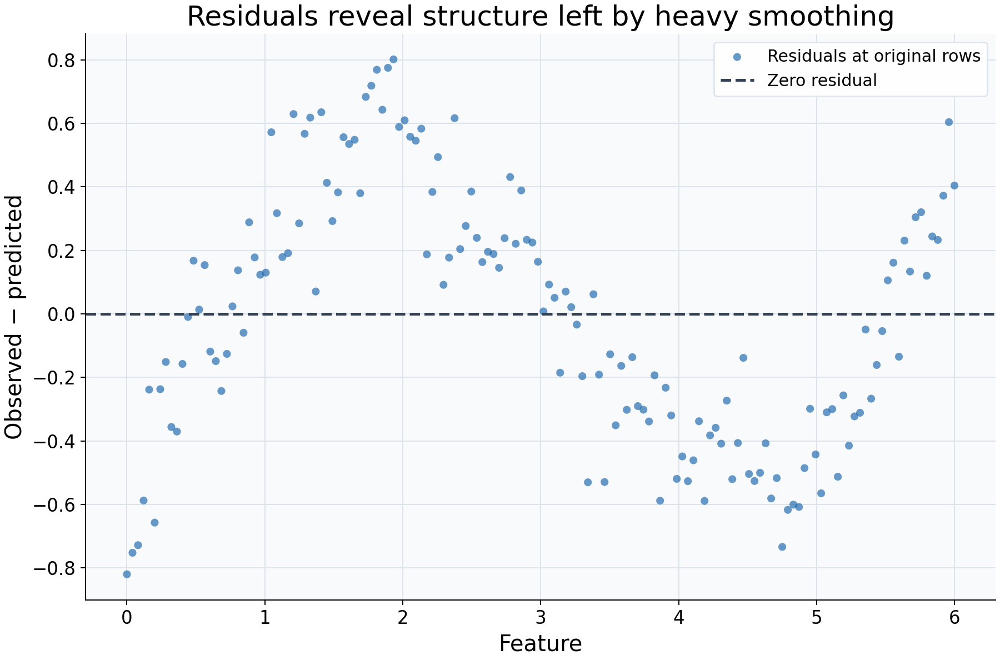

# Inspecting residual structure

## What this example reviews

This example reviews what a fitted curve leaves unexplained. A deliberately broad
Gaussian bandwidth of 1.4 is applied to a noisy sine relationship. Residuals are
evaluated at the original training features and plotted individually, with no
extra smoothing of the residuals.



## Choices and their impact

| Item                          | What is being reviewed                    | Impact and interpretation                                                                         |
| ----------------------------- | ----------------------------------------- | ------------------------------------------------------------------------------------------------- |
| Horizontal feature coordinate | Where each original observation occurred  | Retains the positional link between a feature value and its residual.                             |
| Blue residual points          | Observed response minus fitted response   | Positive values mean the fit underpredicts the observation; negative values mean it overpredicts. |
| Dashed zero line              | Reference for an exactly fitted response  | Helps reveal runs of residuals with the same sign and deviations from zero.                       |
| Bandwidth 1.4                 | Deliberately heavy smoothing              | Pools broad regions, making it easier to see mean structure the fit has smoothed away.            |
| In-sample evaluation          | A diagnostic of the supplied observations | Describes the fitted training relationship, not generalization error on independent data.         |

## Interpreting the plot

Look for feature-dependent runs of positive or negative residuals rather than
requiring each point to lie close to zero. A curved mean pattern can indicate
that the smoothing scale is too broad for the relationship. Individual large
residuals can arise from noise, unusual responses, or inadequate fit and deserve
context rather than automatic removal.

Also examine changes in vertical spread, local support, and the underlying response
plot. Mean structure and changing variability are different phenomena. A visually
patternless residual plot does not establish independence, constant variance, or
correct model specification; a visible pattern is a diagnostic prompt, not a p-value.

## When this is useful

Use residuals to check whether an exploratory curve misses systematic shape and
to identify regions needing closer examination. The diagnostic table records
observed, predicted, residual, and support values together, making unexpected
points easier to inspect.

Unsupported residuals remain NaN in the table and cannot be drawn. For predictive
performance, pass aligned held-out pairs to `regression_diagnostics` and evaluate
appropriate scores. An in-sample curve chosen for very small residuals may simply
fit noise.

## Explore further

Compare bandwidths 0.4 and 1.4 on the same data. Fit a local-linear curve and
inspect residuals near the feature boundaries. Finally, evaluate a separate
held-out sample to distinguish training diagnostics from prediction error.

## Run this example

From the checkout, with `rgram[plot]` installed:

```bash
python examples/plot_relationships.py --example residuals
# Save just this figure without opening a desktop window:
python examples/plot_relationships.py --example residuals --output-dir /tmp/rgram-figures
```

Download [this standalone example](../_static/examples/residuals.py).
The complete code below includes imports, data, configuration, and plotting.
Run the downloaded file with `python residuals.py`.

```python
from __future__ import annotations

import argparse
from pathlib import Path
from typing import TYPE_CHECKING
import warnings

import numpy as np

from rgram import KernelSmoother, Regressogram, SupportWarning, quantile

if TYPE_CHECKING:
    from matplotlib.axes import Axes
    from matplotlib.figure import Figure

# A consistent palette makes comparisons readable across the gallery.
COLORS = ["#1764ab", "#de682b", "#21856b", "#8855a2"]


def _create_axes(
    title: str, xlabel: str = "Feature", ylabel: str = "Response"
) -> tuple[Figure, Axes]:
    """Create a readable, single-panel figure with consistent gallery styling."""
    import matplotlib.pyplot as plt

    with plt.rc_context({"font.size": 14, "axes.labelsize": 16, "axes.titlesize": 20}):
        figure, ax = plt.subplots(figsize=(10, 6.6), layout="constrained")
        ax.set(title=title, xlabel=xlabel, ylabel=ylabel)
    ax.set_facecolor("#f8fafc")
    ax.grid(color="#dce3ec", linewidth=0.8)
    ax.set_axisbelow(True)
    ax.spines[["top", "right"]].set_visible(False)
    ax.tick_params(labelsize=13)
    return figure, ax


def _plot_observations(ax: Axes, X: np.ndarray, y: np.ndarray) -> None:
    """Show original rows without connecting them or hiding response spread."""
    ax.scatter(
        X,
        y,
        color="#64748b",
        alpha=0.4,
        s=28,
        edgecolors="none",
        label="Observed responses",
    )


def _add_legend(ax: Axes) -> None:
    """Identify every plotted comparison using the same readable legend style."""
    ax.legend(fontsize=12, framealpha=0.96, edgecolor="#dce3ec", loc="best")


def _gaussian_smoother(bandwidth: float, **kwargs) -> KernelSmoother:
    """Keep kernel and bandwidth units explicit; kwargs select other model options."""
    return KernelSmoother(
        kernel="gaussian", bandwidth="manual", bandwidth_value=bandwidth, **kwargs
    )


def residuals() -> Figure:
    """Use residuals to inspect structure remaining after heavy smoothing."""
    rng = np.random.default_rng(22)
    X = np.linspace(0, 6, 150)
    y = np.sin(X) + rng.normal(0, 0.15, len(X))
    # Intentionally smooth heavily to leave a visible mean pattern in residuals.
    model = _gaussian_smoother(1.4).fit(X, y)
    # Residuals are observed minus predicted, evaluated at the original rows.
    # These are in-sample diagnostics, not a held-out accuracy estimate.
    diagnostic = model.regression_diagnostics(X, y)
    figure, ax = _create_axes(
        "Residuals reveal structure left by heavy smoothing",
        ylabel="Observed − predicted",
    )
    ax.scatter(
        X,
        diagnostic["residual"].to_numpy(),
        color=COLORS[0],
        alpha=0.65,
        s=32,
        edgecolors="none",
        label="Residuals at original rows",
    )
    # The zero line helps distinguish systematic underprediction and overprediction.
    ax.axhline(0, color="#334155", linestyle="--", lw=2, label="Zero residual")
    _add_legend(ax)
    return figure

if __name__ == "__main__":
    import matplotlib.pyplot as plt

    figure = residuals()
    plt.show()
    plt.close(figure)
```
