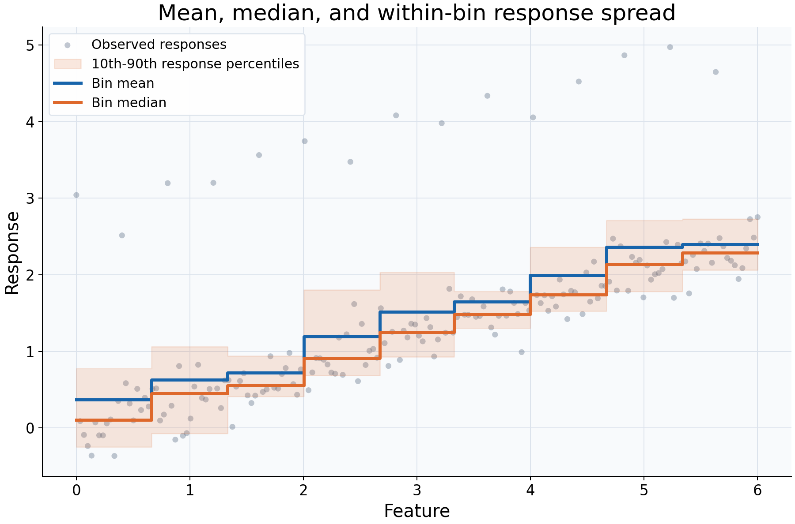

# Means, medians, and response spread

## What this example reviews

This example reviews the statistical summary of the response, rather than the
smoothing resolution. The same observations and nine quantile bins are used for
the mean and median. Every twelfth response is deliberately increased by 2.8
units; no observation is removed. The median fit also reports descriptive 10th
and 90th response percentiles within each bin.



## Choices and their impact

| Item                                        | What is being reviewed                               | Impact and interpretation                                                                                                       |
| ------------------------------------------- | ---------------------------------------------------- | ------------------------------------------------------------------------------------------------------------------------------- |
| Gray observations, including high responses | The full response distribution supplied to both fits | The extreme responses remain visible and participate in aggregation.                                                            |
| Blue mean curve                             | Arithmetic average within each bin                   | Every response value contributes to the total; unusually large responses can raise the average.                                 |
| Orange median curve                         | Middle response within each bin                      | Responds differently to the deliberately added high values because it describes the center by rank, not the arithmetic average. |
| Shaded percentile envelope                  | Within-bin 10th-90th response percentiles            | Describes response spread among observed rows in a cell, not uncertainty about the fitted mean or median.                       |
| Shared binning                              | A controlled comparison of summary statistics        | Differences between these curves come from aggregation rather than different cell boundaries.                                   |

## Interpreting the plot

Look at how high responses pull the mean relative to the median, then relate the
percentile envelope to the observations in each feature interval. The better
summary depends on the question: a mean is relevant to an average or total-based
quantity, while a median describes a typical middle response.

The envelope is returned through `summary_lower` and `summary_upper` in diagnostics
because it is a descriptive bin summary. It is not a bootstrap interval, a
simultaneous band, or a guaranteed coverage interval for future responses.
A wider envelope can reflect more heterogeneous responses without necessarily
meaning the central curve is estimated less precisely.

## When this is useful

Use this comparison when exploring skewed responses, sensitivity to extreme
observations, or differences between an average and a typical response. Quantile
summaries can also reveal spread that a single central curve conceals.

Choosing a median changes the target statistic; it is not an automatic cleaning
step and does not make the kernel smoother a robust-regression estimator. Small
bin samples can make quantiles unstable, so inspect counts before treating the
envelope as a detailed description of the response distribution.

## Explore further

Change the size or frequency of the deliberately high responses. Try other
`quantile(q)` values or a different bin count, then distinguish changes in the
central summary from changes in the descriptive spread. For uncertainty about a
chosen fitted statistic, use `predict_interval` and its resampling assumptions.

## Run this example

From the checkout, with `rgram[plot]` installed:

```bash
python examples/plot_relationships.py --example summaries
# Save just this figure without opening a desktop window:
python examples/plot_relationships.py --example summaries --output-dir /tmp/rgram-figures
```

Download [this standalone example](../_static/examples/summaries.py).
The complete code below includes imports, data, configuration, and plotting.
Run the downloaded file with `python summaries.py`.

```python
from __future__ import annotations

import argparse
from pathlib import Path
from typing import TYPE_CHECKING
import warnings

import numpy as np

from rgram import KernelSmoother, Regressogram, SupportWarning, quantile

if TYPE_CHECKING:
    from matplotlib.axes import Axes
    from matplotlib.figure import Figure

# A consistent palette makes comparisons readable across the gallery.
COLORS = ["#1764ab", "#de682b", "#21856b", "#8855a2"]


def _create_axes(
    title: str, xlabel: str = "Feature", ylabel: str = "Response"
) -> tuple[Figure, Axes]:
    """Create a readable, single-panel figure with consistent gallery styling."""
    import matplotlib.pyplot as plt

    with plt.rc_context({"font.size": 14, "axes.labelsize": 16, "axes.titlesize": 20}):
        figure, ax = plt.subplots(figsize=(10, 6.6), layout="constrained")
        ax.set(title=title, xlabel=xlabel, ylabel=ylabel)
    ax.set_facecolor("#f8fafc")
    ax.grid(color="#dce3ec", linewidth=0.8)
    ax.set_axisbelow(True)
    ax.spines[["top", "right"]].set_visible(False)
    ax.tick_params(labelsize=13)
    return figure, ax


def _plot_observations(ax: Axes, X: np.ndarray, y: np.ndarray) -> None:
    """Show original rows without connecting them or hiding response spread."""
    ax.scatter(
        X,
        y,
        color="#64748b",
        alpha=0.4,
        s=28,
        edgecolors="none",
        label="Observed responses",
    )


def _add_legend(ax: Axes) -> None:
    """Identify every plotted comparison using the same readable legend style."""
    ax.legend(fontsize=12, framealpha=0.96, edgecolor="#dce3ec", loc="best")


def _gaussian_smoother(bandwidth: float, **kwargs) -> KernelSmoother:
    """Keep kernel and bandwidth units explicit; kwargs select other model options."""
    return KernelSmoother(
        kernel="gaussian", bandwidth="manual", bandwidth_value=bandwidth, **kwargs
    )


def summaries() -> Figure:
    """Compare a bin mean, median, and descriptive quantile envelope."""
    rng = np.random.default_rng(17)
    X = np.linspace(0, 6, 180)
    y = 0.4 * X + rng.normal(0, 0.22, len(X))
    # Add extreme responses deliberately; both estimators receive every row.
    y[::12] += 2.8  # Deliberate extreme responses, not removed during fitting.
    query = np.linspace(0, 6, 350)
    # Identical bin boundaries isolate the choice of response summary.
    mean = Regressogram(n_bins=9).fit(X, y)
    median = Regressogram(
        n_bins=9, agg="median", ci=(quantile(0.1), quantile(0.9))
    ).fit(X, y)
    # ci supplies descriptive response percentiles, not a bootstrap interval.
    # Read the named columns so the statistical meaning stays explicit.
    diagnostic = median.predict_diagnostics(query)
    figure, ax = _create_axes("Mean, median, and within-bin response spread")
    _plot_observations(ax, X, y)
    # The envelope reports within-bin response spread, not certainty of the curve.
    ax.fill_between(
        query,
        diagnostic["summary_lower"].to_numpy(),
        diagnostic["summary_upper"].to_numpy(),
        step="mid",
        color=COLORS[1],
        alpha=0.15,
        label="10th-90th response percentiles",
    )
    ax.step(
        query,
        mean.predict(query),
        where="mid",
        color=COLORS[0],
        lw=2.8,
        label="Bin mean",
    )
    ax.step(
        query,
        median.predict(query),
        where="mid",
        color=COLORS[1],
        lw=2.8,
        label="Bin median",
    )
    _add_legend(ax)
    return figure

if __name__ == "__main__":
    import matplotlib.pyplot as plt

    figure = summaries()
    plt.show()
    plt.close(figure)
```
