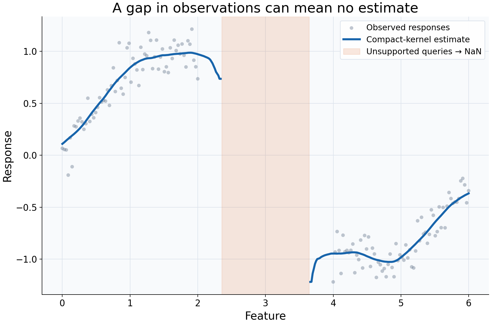

# Recognizing unsupported queries

## What this example reviews

This example reviews whether a query has enough local information to produce
any estimate. Training features occupy 0-2 and 4-6, leaving a deliberate gap.
An Epanechnikov kernel with bandwidth 0.35 has compact support, so it cannot reach
training observations from the middle of that gap.



## Choices and their impact

| Item                              | What is being reviewed                              | Impact and interpretation                                                                                                             |
| --------------------------------- | --------------------------------------------------- | ------------------------------------------------------------------------------------------------------------------------------------- |
| Gray observations                 | Where feature/response pairs are actually available | The empty middle is a lack of observations, not merely a visual omission.                                                             |
| Blue curve segments               | Queries with positive numerical kernel support      | Predictions are drawn where observations contribute to the local fit.                                                                 |
| Broken line                       | Unsupported predictions retained as NaN             | No interpolation is added to hide missing estimates. Query rows remain in the diagnostic table.                                       |
| Orange region                     | Locations flagged as unsupported                    | Distinguishes absence of an estimate from an estimate with high error.                                                                |
| Bandwidth 0.35 and compact kernel | The distance within which rows may contribute       | Changing either setting changes the support geometry as well as the fitted curve.                                                     |
| Overall training range            | Minimum and maximum observed feature values         | All displayed queries are inside this range, but some are still unsupported. Range membership and local support are different checks. |

## Interpreting the plot

Read the break in the curve as missing information under the configured model,
not as a zero response or an abrupt change in the relationship. The estimator
returns NaN for those queries; Matplotlib leaves a break rather than connecting
supported endpoints through the empty region.

The script suppresses only the expected `SupportWarning` within this deliberately
constructed example because the missing support is explicitly displayed. It does
not replace NaNs, drop rows, or disable validation. In an analysis pipeline,
inspect `supported` and `in_training_range` before interpreting or scoring predictions.

## When this is useful

Use support diagnostics when features have gaps, tails are sparsely sampled,
subgroup ranges differ, or a scorer encounters NaN predictions. This distinguishes
a parameter choice that cannot estimate a query from a numerical curve that merely
looks smooth.

A Gaussian kernel or larger bandwidth may give finite predictions through the gap.
That would change the pooling assumption, not supply missing observations or prove
that the estimated relationship is reliable there. Finite coverage is a computational
requirement, not an accuracy guarantee.

## Explore further

Try a smaller bandwidth and observe where the gap widens. Try a Gaussian kernel,
then inspect its local weights in the gap. Set `unsupported="raise"` to fail
explicitly when a downstream prediction task requires every query to be supported.

## Run this example

From the checkout, with `rgram[plot]` installed:

```bash
python examples/plot_relationships.py --example support
# Save just this figure without opening a desktop window:
python examples/plot_relationships.py --example support --output-dir /tmp/rgram-figures
```

Download [the complete gallery script](https://github.com/JackGreenaway/Rgram/blob/main/examples/plot_relationships.py).
The function below is the implementation used to generate this plot. Inline
comments explain the modeling decisions and interpretation of diagnostic values.
It returns a figure; the CLI handles displaying or saving it and then closes it.
The [shared helpers](../examples.md#code-structure-and-shared-helpers) supply only
common styling and explicit Gaussian/manual-bandwidth configuration. Run the
complete downloaded script using the command above.

```python
def support() -> Figure:
    """Expose a feature gap rather than drawing a supported curve across it."""
    rng = np.random.default_rng(23)
    # Leave a deliberate gap: no observations are available between 2 and 4.
    X = np.r_[np.linspace(0, 2, 70), np.linspace(4, 6, 70)]
    y = np.sin(X) + rng.normal(0, 0.12, len(X))
    query = np.linspace(0, 6, 350)
    # This compact kernel reaches at most 0.35 feature units from a query.
    model = KernelSmoother(
        kernel="epanechnikov", bandwidth="manual", bandwidth_value=0.35
    ).fit(X, y)
    # Suppress only the expected support advisory; the orange region and broken
    # line make those unsupported rows explicit, and NaN values are retained.
    with warnings.catch_warnings():
        warnings.simplefilter(
            "ignore", SupportWarning
        )  # Gap is highlighted explicitly below.
        diagnostic = model.predict_diagnostics(query)
    # Query support is distinct from being inside the overall training range.
    unsupported = ~diagnostic["supported"].to_numpy()
    figure, ax = _create_axes("A gap in observations can mean no estimate")
    _plot_observations(ax, X, y)
    ax.plot(
        query,
        diagnostic["prediction"].to_numpy(),
        color=COLORS[0],
        lw=3,
        label="Compact-kernel estimate",
    )
    ax.axvspan(
        query[unsupported].min(),
        query[unsupported].max(),
        color=COLORS[1],
        alpha=0.15,
        label="Unsupported queries → NaN",
    )
    _add_legend(ax)
    return figure
```
